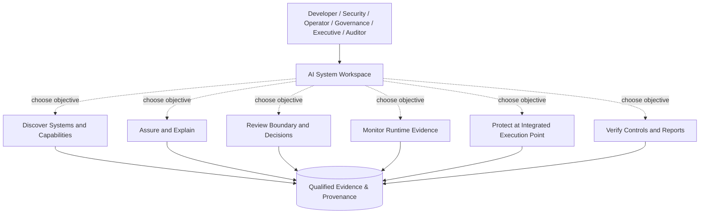
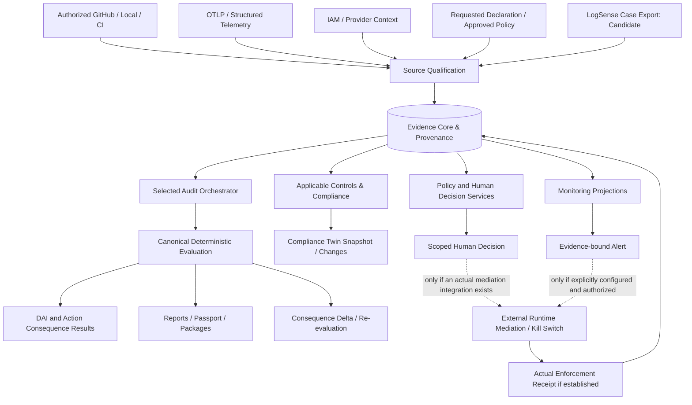

# Website Architecture Visuals and Independent Workflow Specifications

> **2026-10-18 ADDENDUM — actual deterministic graph vs illustrative diagrams:** [Independent uploaded topology mock review, six SVG source checks and Mermaid API/MCP source](ACTION-TOPOLOGY-MOCK-DETERMINISTIC-ENGINE-AND-SIX-DIAGRAMS-INDEPENDENT-REVIEW-2026-10-18.md). These diagram specs and six static SVGs are **product illustrations only**; they are never graph evidence. **Actual built topology** is `buildTopologyProjection` / exact `buildEvaluatedActionMapProjection` + canonical ActionProofTrace/AgentTrace. **Shipped portable Mermaid** already exists at `GET /api/inventory/systems/{id}/agent-trace?basis=current|evaluation&evaluationId=...&format=mermaid` and MCP `haiec_get_agent_trace` with `format:'mermaid'` (`system:read`, tenant-bound). Never manufacture multi-system issuer/handoff/target/effect edges: [E62 contract](E62-CROSS-SYSTEM-DAI-DELEGATION-ENGINEERING-CONTRACT-2026-10-20.md) remains proposed. Existing six SVGs have `title`, `desc`, `aria-labelledby`, no observed script/external refs/handler/duplicate IDs in static source review; this does not replace mobile/AT screenshots. For next visual editing, normalize six customer jobs as Discover/Evaluate/Authorize/Monitor/Protect/Verify; preserve 3 pillars (V3's 4 are engineering domains, not new product pillars), and visually distinguish optional operation paths from mandatory numbered stages. No new runtime diagram or website image publication authorized by this note.

**Goal:** Retire misleading four-stage pipeline art in favor of homepage-ready, source-qualified product and engineering diagrams. Never recreate technical producer implementations inside frontend components.

## Canonical diagram assets

1. `diagrams/haiec-platform-workflows.svg` — Homepage hero-to-product explanatory visual, 1440×830. Personae → common AI System Workspace → six independently invoked, optional workflows → qualified-evidence foundation. This is the **preferred main website visual**.
2. `diagrams/haiec-technical-evidence-architecture.svg` — Technical architecture detail, 1600×1050. Parallel source types feed evidence core; selected assurance runs, policy/human review, operational protection and compliance have distinct owner/activation paths. No universal execution graph is implied.

Both diagrams are labeled illustrative, visually editable text SVG, use non-executable markup, and have title/description for screen readers. They are **not** live product evidence or a representation of verified customer integrations.

## Design concept A — Website product overview

**Diagram semantics:** The dashed links are *entry choices*, not synchronous product dependencies. Arrows toward Evidence mean each capability can consume and/or contribute bounded evidence via its canonical source contract; they do not require all six modules to run.

## Design concept B — Engineering architecture

**Engineering note:** External runtime control has an independent operational availability and safety path; this diagram does not claim customer-side integration or guarantee feedback-loop delivery.

## Objective-to-workflow routing matrix

| Intent | Entry point | Own prerequisites | Explicitly optional | Output view |
|---|---|---|---|---|
| Check my AI app | IDE/MCP, GitHub, CLI | Scoped caller and qualifying source for requested analysis | IAM, telemetry, full compliance, Kill Switch | Findings and evidence coverage |
| What can my agent do | System Explorer | Qualified source/declaration facts | Monitoring, regulatory catalog | Reachability and gaps |
| Can this agent take this action | Authority and DAI | Relevant approved delegation + specific action-path evidence | General compliance review | Bounded comparison with limitations |
| Review a deployment | Decisions | Authorized reviewer and scoped request | Kill Switch, Compliance Twin | Versioned human decision |
| Monitor actions | Operations | Bound telemetry signal source | Static scan, approvals not applicable to passive monitoring | Source health and action observations |
| Contain a dangerous action | Operations | Proven enforcement integration + permitted operator | Audit run, regulatory assessment | Verified applied control only if receipt exists |
| Are we compliant | Compliance | Applicable framework/control evidence | Repository, telemetry where not required | Evidence-linked control outcomes |
| What changed | Changes | Two comparable snapshots | Other product families | Consequence or compliance delta |
| Investigate a past incident | LogSense | Committed local evidence | Cloud connection, HAIEC account | Deterministic forensic summary |

## Organization/module resolver

Inputs must include `organizationId` from authenticated context; `aiSystemId` scoped to org; `userRole` and permission scopes; commercial entitlement; source state; evidence coverage; profile applicability; approval status. Recommended UI decisions: `AVAILABLE`, `NOT_APPLICABLE`, `CONNECT_SOURCE`, `NEED_EVIDENCE`, `NEED_APPROVAL`, `NOT_AUTHORIZED`, `NOT_ENTITLED`, `HELD`, `UNSUPPORTED`.

Do not hide a safety-critical operational action based solely on UI gating; server-side authority checks remain mandatory. Do not imply a missing commercial entitlement is an assurance failure.

## Exact website implementation surfaces inspected

- `app/page.tsx` — current homepage; Section A is hero/MCP terminal, A2 is multiple-entry-point narrative, B is risk patterns. Insert product diagram near A2/B boundary; keep valuable source-specific MCP transcript and AuthorityPlanesFigure instead of indiscriminately replacing them.
- `components/homepage/HeroMcpTerminal.tsx` and `components/hero/ProductShowcase.tsx` — truthful labeled illustrative prompt flows already exist; do not invent callable `haiec_check` as shipped until tool registry has it.
- `components/homepage/AuthorityPlanesFigure.tsx` — five separate examples. Preserve independence and explicit `Illustrative trace` label.
- `components/homepage/ThreeSteps.tsx` — historical marketing section uses `Three steps. Full compliance.` Avoid use as universal HAIEC product lifecycle; check actual homepage use before editing.
- `lib/mcp/capability-guide.ts` and `lib/developer-integration-source-status.ts` — source of platform readiness copy; any images claiming hosted integration must match these contracts.

## Publish / acceptance criteria

- Use static SVG files in `public/architecture/` or convert to React components with a source annotation. React must not recompute statuses or invent metrics.
- Keep primary homepage visual compact, lazy-load technical architecture or link to technical page. For mobile avoid unreadable shrunk tiny SVG; use horizontally scrollable visual with HTML text alternative.
- Provide `alt`, figcaption, traceable source status and explicit role of illustration. No SVG scripts/foreignObjects/external references.
- Check existing CTA routes and access, mobile, 200% zoom, keyboard, light/dark contrast, snapshot semantic labels, and avoid layout shifts.
- Implement on feature branch with PR and review. Any merge to `Main` triggers production deployment; verify actual deploy before marking live.
