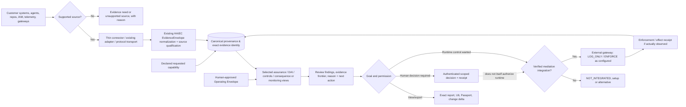

# HAIEC Enterprise Assurance: Own vs Reuse vs Integrate — Deep Product Decision
**Reviewed:** 2026-10-16 | **Artifact home:** `subodhkc/common-repo-drive/haiec-product-capability-architecture`
**Read-only baseline:** HAIEC `Main` tree `b2c1489773bd95b9e361714fbf7c808bbc866ffb`; source-backed inspection plus external vendor documentation (links at end). **No HAIEC product code changes or production tests.** No claim of exhaustive implemented-feature inventory.

## Decision in one page

**Maintain a deliberate freeze on new horizontal product families.** Use the existing HAIEC canonical deterministic assurance engine and ship one fully credible organization-aware, user-aware, evidence-bound enterprise workflow. Reuse externally mature transport, enforcement, identity, telemetry and audit formats. Keep HAIEC ownership of *evidence qualification, delegated authority, reachability, effect envelope, DAI, consequence comparison, assurance disposition, versioned decisions, evidence frontiers and verifiable evaluation lineage*.

Three marketing pillars: **Understand / Assure / Govern & Operate**. Six independently available jobs: **Discover / Evaluate / Authorize / Monitor / Protect / Verify**. Do not force a universal stage sequence, mandatory repository manifest, full IAM connection, runtime protection or regulatory profile.

A differentiating sentence: **“HAIEC independently determines what an AI system can cause, whether that consequence was authorized, what actually occurred, and what the available evidence can establish.”** This is a proposed positioning statement, not a claim of universal producer coverage.

## 1. Correction to previous audit: mature internal foundations already exist

| Foundation and code anchor | Grounded fact | Reality / action |
|---|---|---|
| [lib/evidence/adapters/otlp-receiver.ts](https://github.com/subodhkc/haiec-website/blob/b2c1489773bd95b9e361714fbf7c808bbc866ffb/lib/evidence/adapters/otlp-receiver.ts) | OTLP trace/log/metric into canonical structured ingress with explicit receipt!=effect semantics | **Reuse**, do not build a second general OTLP receiver. Qualify source health, freshness, correlation and collector scaling separately. |
| [lib/evidence/streaming-telemetry-collector.ts](https://github.com/subodhkc/haiec-website/blob/b2c1489773bd95b9e361714fbf7c808bbc866ffb/lib/evidence/streaming-telemetry-collector.ts) | Bounded batch drain, dedup and quarantine | **Reuse**; not itself continuous daemon or full durability guarantee. |
| [lib/evidence/telemetry-readiness.ts](https://github.com/subodhkc/haiec-website/blob/b2c1489773bd95b9e361714fbf7c808bbc866ffb/lib/evidence/telemetry-readiness.ts) | Three states NOT_CONFIGURED/CONFIGURED_NO_SIGNAL/SIGNAL_RECEIVED, not evidence-qualified PASS | **Reuse** in UI and MCP. |
| [lib/assurance/monitoring-read-model.ts](https://github.com/subodhkc/haiec-website/blob/b2c1489773bd95b9e361714fbf7c808bbc866ffb/lib/assurance/monitoring-read-model.ts) | Real read projection from tenant-bound sources/evidence; includes OTLP types | **Improve** alert-to-action, retention/freshness and source-health UX, not an alternate monitoring datastore. |
| [lib/mcp/ide-tools.ts](https://github.com/subodhkc/haiec-website/blob/b2c1489773bd95b9e361714fbf7c808bbc866ffb/lib/mcp/ide-tools.ts), [lib/mcp/capability-guide.ts](https://github.com/subodhkc/haiec-website/blob/b2c1489773bd95b9e361714fbf7c808bbc866ffb/lib/mcp/capability-guide.ts) | Registered IDE orchestration and guided goal-to-tool/scopes derived from registries | **Compose**, don't create a new `haiec_check` engine. Optional alias only after registry/trust review. |
| [lib/ai-inventory/system-next-action.ts](https://github.com/subodhkc/haiec-website/blob/b2c1489773bd95b9e361714fbf7c808bbc866ffb/lib/ai-inventory/system-next-action.ts), [lib/ai-inventory/next-action-access.ts](https://github.com/subodhkc/haiec-website/blob/b2c1489773bd95b9e361714fbf7c808bbc866ffb/lib/ai-inventory/next-action-access.ts) | Deterministic next action, separate entitlement annotation | **Compose**, do not replace order/permission semantics with assistant guesses. |
| [lib/assurance/operating-envelope.ts](https://github.com/subodhkc/haiec-website/blob/b2c1489773bd95b9e361714fbf7c808bbc866ffb/lib/assurance/operating-envelope.ts) | Approved policy envelopes, versioned and immutable approval histories | **Own**. A draft declaration never becomes a policy decision. |
| [lib/assurance/deployment-decision.ts](https://github.com/subodhkc/haiec-website/blob/b2c1489773bd95b9e361714fbf7c808bbc866ffb/lib/assurance/deployment-decision.ts), [lib/assurance/deployment-decision-persistence.ts](https://github.com/subodhkc/haiec-website/blob/b2c1489773bd95b9e361714fbf7c808bbc866ffb/lib/assurance/deployment-decision-persistence.ts) | Human review/approval scoped to request and separate from assurance and runtime authorization | **Own + expose** in executive/governance workflow. |
| [lib/assurance/guardrail-decision-transition.ts](https://github.com/subodhkc/haiec-website/blob/b2c1489773bd95b9e361714fbf7c808bbc866ffb/lib/assurance/guardrail-decision-transition.ts), [lib/assurance/guardrail-decision-persistence.ts](https://github.com/subodhkc/haiec-website/blob/b2c1489773bd95b9e361714fbf7c808bbc866ffb/lib/assurance/guardrail-decision-persistence.ts) | Evidentiary ladder and real decision persistence exist | **Extend to qualified runtime receipts**; do not describe as merely contract-only. Per-customer dispatch proof remains separate. |
| [lib/integrations/model-gateway/enforcement-sdk.ts](https://github.com/subodhkc/haiec-website/blob/b2c1489773bd95b9e361714fbf7c808bbc866ffb/lib/integrations/model-gateway/enforcement-sdk.ts) | Bounded gateway hook delegates to existing control dispatcher for a particular use case | **Reuse**; present limited modeled control, not universal action mediation. |
| [lib/integrations/agentcore-gateway/preflight.ts](https://github.com/subodhkc/haiec-website/blob/b2c1489773bd95b9e361714fbf7c808bbc866ffb/lib/integrations/agentcore-gateway/preflight.ts) | Read-only actual MCP reachability and safe call via AgentCore Gateway | **Build an adapter on top**, does not establish AgentCore policy ENFORCE or full behavior. |
| [lib/iam-grant/effective-grant-observation.ts](https://github.com/subodhkc/haiec-website/blob/b2c1489773bd95b9e361714fbf7c808bbc866ffb/lib/iam-grant/effective-grant-observation.ts) | AWS IAM observer explicit **PARTIAL** authority, no canonical EFFECTIVELY_GRANTED assertion | **Preserve**, target precise additional authorization context only where available. |
| [lib/evidence/adapters/logsense-competition-bundle.ts](https://github.com/subodhkc/haiec-website/blob/b2c1489773bd95b9e361714fbf7c808bbc866ffb/lib/evidence/adapters/logsense-competition-bundle.ts) | LogSense scoped technical measurements can be qualified external evidence, cannot author HAIEC verdict | **Reuse** and generalize only after tested handoff. |
| [lib/evidence/adapters/cyclonedx-intake.ts](https://github.com/subodhkc/haiec-website/blob/b2c1489773bd95b9e361714fbf7c808bbc866ffb/lib/evidence/adapters/cyclonedx-intake.ts) | Bounded CycloneDX JSON intake already exists | **Reuse**; no full SBOM vulnerability-verdict claim. |
| [lib/assurance/assurance-product-adapters.ts](https://github.com/subodhkc/haiec-website/blob/b2c1489773bd95b9e361714fbf7c808bbc866ffb/lib/assurance/assurance-product-adapters.ts), [lib/assurance/agentic-production-passport.ts](https://github.com/subodhkc/haiec-website/blob/b2c1489773bd95b9e361714fbf7c808bbc866ffb/lib/assurance/agentic-production-passport.ts) | Exact-evaluation output bundle, report and passport with provenance restrictions | **Improve export consumer UX**, not new report engine. |
| [lib/assurance/profile-resolver.ts](https://github.com/subodhkc/haiec-website/blob/b2c1489773bd95b9e361714fbf7c808bbc866ffb/lib/assurance/profile-resolver.ts) | Deterministic specialized profile selection, no weak fallback | **Reuse** for customer-specific applicability, never imply every control is universally mandatory. |

**Important stale text check:** The comment in `lib/assurance/dai-observed-scope.ts` says there is no OTLP receiver, but an OTLP receiver exists today. Treat the former as stale module commentary, not platform truth. Similarly a comment inside `guardrail-decision.ts` describing "contract only" is accurate for its original batch, not the later transition/persistence modules.

## 2. Capability investment matrix: own vs improve vs transport vs ignore

| Domain | Decision | Reuse/partner | HAIEC retains | Priority/trigger |
|---|---|---|---|---|
| Five evidence planes, deterministic qualification, frontier honesty | **OWN AND DIFFERENTIATE** | Standard source schemas as input | canonical provenance, epistemic state, comparability, cross-source authority | P0, core moat |
| DAI, delegation and consequence graph/effect envelopes | **OWN AND DIFFERENTIATE** | Joern/Semgrep produce bounded facts | semantic action identity, scoped delegation vs reachability and confirmed effects | P0/P1 |
| Human operating authority and release decisions | **IMPROVE OWN CORE** | GitHub checks / enterprise ticketing as transport | approved envelope, reviewer authority, SoD, decision version/expiry, binding to exact evaluation | P1 |
| Agent inventory/registry | **REUSE + ENRICH** | Microsoft Agent Registry/Entra, AWS, code graph, CI, APIs | reconciled agent/action/system identity, unknowns, duplicate-resolution | P1; do not build another generic asset CMDB |
| Cloud IAM identity | **TRANSPORT + QUALIFY** | Entra Agent ID, AWS IAM/AgentCore; later GCP | bounded effective grant determination; never infer true grant from identity-policy allow | P1 AWS first, Azure only selected POC |
| Telemetry collection, trace and alert transportation | **REUSE STANDARDS** | OpenTelemetry Collector, GenAI and MCP semantic conventions, existing observability/OTLP exporters | evidence admission, source reliability, event/action/effect correlations, unknown coverage, deterministic alert rules | P1 |
| Runtime enforcement | **INTEGRATE, NOT REBUILD** | AWS AgentCore Gateway Policy, customer API gateway, OPA/Cedar and established policy engines | prove intended vs enforced, detect unmediated paths, policy changes, action receipts | P1 one protected action |
| Tenant/project access control | **KEEP CURRENT + EVALUATE** | Current org/RBAC rules; OpenFGA if real fine-grained scale requires it | enforce real server tenant/scope decisions, protect audit evidence | P0 verify; migrate only measured need |
| Policy authoring | **REUSE PARSERS/EXECUTORS** | OPA/Rego or Cedar for supported customer enforcement; source policy format and native APIs | HAIEC canonical authorized envelope and decision evidence; no one-to-one semantic assumption | P2 conditional |
| Prompt/LLM tracing and model usage | **TRANSPORT, NOT A NEW OBSERVABILITY SAAS** | Existing OpenAI/Anthropic wrapper; OTel/Langfuse/OpenInference where authorized | separate usage observation from tools/actions/committed effect | P2 only trace-action proof |
| Incident case reconstruction | **REUSE LOGSENSE** | Separate LogSense as producer, security platform logs | qualified action-consequence findings and control effects | P1 selected enterprise case |
| Control catalogs and compliance mapping | **USE OPEN STANDARDS, KEEP EVALUATION** | NIST OSCAL, OWASP Agentic, customer GRC import/export | executable rule applicability, proof and status, audit lineage | P2; no catalog inflation |
| Supply-chain inventory | **REUSE SCHEMAS/TOOLS** | CycloneDX/Trivy/OSV/Dependabot ecosystem | confirm capability or tool reachability consequences from imported facts | P2 if source relevant |
| Artifact signature/transparency | **EXTEND USING EXISTING TOOLS** | Sigstore/cosign or enterprise KMS signed bundles | exact U6 lineage and truthful verification semantics | P2 optional signed export, no claims of blanket immutability |
| General deployment pipeline | **TRANSPORT ONLY** | GitHub Actions / Vercel / existing pipelines | policy-based release gate and reviewer/deployment decision receipts | P1 one workflow |
| General SOC/SIEM/EDR | **IGNORE BUILD** | Splunk, Sentinel, Datadog, Defender, etc. | event admission / actionable consequence analysis | No platform clone |
| Enterprise IAM provider / MFA / SSO | **IGNORE BUILD** | Customer IdP and access providers | bind trusted principal/role and delegated authority, verify current scope | Integrate only |
| Generic agent builder/orchestrator | **IGNORE BUILD** | Accenture, Microsoft, AWS, Google, LangGraph, etc. | independent action assurance | Never core goal |
| General LLM evaluation/prompt ranking | **IGNORE BUILD** | Langfuse, MLflow, provider evals | targeted tests that establish high-impact consequences | Only as bounded evidence producer |
| New fourth/fifth universal stage | **IGNORE** | — | 3 pillars; six independent jobs; branching operational topology | Product simplification |
| Mandatory `haiec.json`, `BOUNDARY.md`, `GUARDRAILS.md`, `AGENTS.md` | **OPTIONAL USER-SUPPLIED CONTEXT** | Generate starter examples, not mandatory setup | typed REQUESTED proposals, explicit version approval, evidence gap clarification | P1 friction only |

## 3. Suggested interoperable architecture (not a new execution engine)

The arrows mean candidate fact flow or task-specific relationships, **not** all workflow steps mandatory. In particular, monitoring may start without static analysis; compliance may run without GitHub; a preconfigured emergency Kill Switch does not wait for an audit.

### Canonical adapter contract (proposed addition, no parallel store)

`IntegrationDescriptor`: provider, API/protocol/spec version, authentication/tenant scope, supported read/write operations, minimum necessary payload, source actor and environment, source authority class, identity-matching strategy, cadence/freshness, request/rate/cost budgets, admitted data classes, raw payload retention policy, supported outcome evidence and explicit `HELD/UNSUPPORTED` feature flags.

`NormalizedEvidence`: canonical EvidenceEnvelope/producerRunId; bound organizationId and aiSystemId; source and producer identity; declared vs provider observed vs HAIEC evaluated provenance; event/correlation/tracing IDs and dedup; actor, action, target, effect, policy/decision refs; time and version; exact evidence refs; applicable limitations.

`ControlReceipt`: policy engine, version/digest, mediation target, principal, action, resource, decision value, mode (SHADOW/LOG_ONLY/ENFORCE), whether checked, whether actually enforced, denial/block outcome, committed effect corroboration, retries and latency basis, integrity signature/provenance, explicit unknowns.

**Adapter policy:** Never let third-party LLM grades, “pass” flags, non-authenticated observations, or an AI-generated manifest become an HAIEC verdict or approved authority. One customer provider may return usable *requested/declared* facts and zero qualified effects: that is a valid partial result.

## 4. The one flagship enterprise proof to build first
### Scenario: consequential agent tool action

**Reference surface:** AWS AgentCore Gateway MCP tool plus current HAIEC deterministic engine. We use AWS first because HAIEC already has a safe Gateway preflight, partial IAM observer, OTLP ingestion and a model gateway/control dispatcher. This is not claiming existing integrated production enforcement.

1. **Connect:** Authorized operator chooses an AI System and connects a GitHub source **or** telemetry/AgentCore target with minimal read-only scopes. No manifest dependency.
2. **Discover:** HAIEC maps an agent→tool→API→resource/effect with source coverage and meaningful limitations.
3. **Assert intent:** Existing requested capability owner records proposed action boundary; humans can inspect and propose an approved Operating Envelope.
4. **Approve policy:** Authenticated reviewer approves versioned envelope; retain policy digest and review event. Never equate this with a deployment decision.
5. **Evaluate:** Run exact-source DAI and consequence comparison. Some planes may be `NOT_ASSESSED`; present them honestly.
6. **Decide deployment:** A separate authorized human reviews outcome. Demonstrate **APPROVED_SCOPED**, **REJECTED**, and **PENDING** on different requests, with no assumption of automatically deployed protection.
7. **Connect enforcement only if requested:** Verify Gateway reachability + policy engine attached + policy mode. Begin LOG_ONLY, observe proposed allow/deny decisions, then let authorized customer opt into ENFORCE. If no hook exists, show `NOT_INTEGRATED`.
8. **Demonstrate executed control:** One allowed read, one prohibited mutation, one conditional action requiring approval. Capture actual provider decision + applied mediation + tool execution/effect outcomes where available; distinguish denied tool call from verified absence of all side effects.
9. **Monitor and reassess:** Capture applicable OTLP traces, source coverage, policy edit/redeployment, runtime drift and Consequence Delta. A missing signal yields missing-observation reason, never 'no violation'.
10. **Verify:** Issue one U6/passport/report bound to exact system, run/evaluation, policy version, reviewer decision, provider control and evidence refs. Optional LogSense imported forensic measurements are external candidate evidence, never a verdict source.
11. **Operational resiliency:** Unauthorized bypass and direct non-gateway call must remain explicitly outside tested enforcement perimeter; test hook bypass at approved POC seam. Include kill/recover independent of assurance run only where proven.
12. **Commercial demonstration:** Executive sees what could happen, what was allowed, what actually happened, what HAIEC could establish, residual exposure, and named human action.

**Go/no-go proof:** Customer can complete this without HAIEC inventing provider/IAM permissions; tenant isolation, policy/applicability and UI/MCP parity survive; actual enforcement is either evidence-backed or precisely declared absent. The demonstration must mark synthetic decisions, synthetic data and real provider observations separately.

## 5. Sequenced implementation, cost-conscious

| Order | Work (incremental) | Changes | Acceptance |
|---|---|---|---|
| **P0a** | Release-truth/caller reachability | Audit 87 matrix + 20 candidates + stub integration importer paths; classify reachable vs held | No simulated cloud control can become verified customer evidence |
| **P0b** | Safe product communication | Remove broad Kill Switch speed and universal integration claims, reconcile module truth/readiness | Every high-stakes page statement traceable to source + appropriate limitation |
| **P0c** | One readiness/entitlement projection | Reuse `capability-guide`, next action, access map, preflight, producer registry | UI/MCP show same goal, blocked reasons, source and actor-specific next action |
| **P1a** | AgentCore provider-evidence binding | Add narrowly scoped adapter that reads policy mode, tool/action and (where authorized) decision logs/trace refs | Provider `LOG_ONLY` never appears as enforced; revision and gateway identity exact |
| **P1b** | One action-to-effect proof path | Connect requested→approved→code capable→observed→enforced/confirmed effect as independently established | One allowed, one denied and one unknown action with clear evidence frontiers |
| **P1c** | Decision and release workflow | Reuse deployed decision persistence + GitHub check/ticket result transport; separate pending/rejected/approved | Authenticated reviewer, version, expiry, revocation, exact evaluation scope |
| **P1d** | Enterprise and developer UX | 3 pillars, 6 jobs, role-aware workspace, four independent statuses, provenance report | Developer can run without IAM; executive sees portfolio/decisions; operator can monitor without a scan |
| **P2a** | Expand integrations only by POC demand | Entra Agent ID identity and/or Langfuse OTLP source read adapter, no generic identity or tracing clone | qualified provider-specific coverage with replayable tests |
| **P2b** | Reporting interoperability | OSCAL export / optional Sigstore proof bundle where demanded | precise claim-mapping, verified signature if used; no fabricated certification |
| **Defer** | New engines, massive compliance expansion, own SIEM/SOC, agent builder, multi-cloud full connectors, AI-grader-as-assurance | nothing | Focus maintained |

**Effort assumption only, not an estimate:** P0 scope is targeted code/UX audit and existing service composition. Actual P1 budget depends on credentials, access to a safe customer/POC Gateway, completeness of tool-event spans, provider policy modes and ability to create protected test action. Do not schedule a universal connector rollout.

## 6. Which models to study—and how
- **Accenture AI Refinery:** Study enterprise delivery playbooks, multi-role adoption, partner integration and measurable outcomes—not agent construction as product roadmap.
- **Microsoft Agent Registry/Entra Agent Identity:** Study agent ownership, identity lifecycle and delegated access—not copy Microsoft tenant directory/entitlement systems. Accept exact provider facts and enrich HAIEC identity continuity.
- **AWS AgentCore Gateway/Policy:** Study the split between policy engine and actual gateway enforcement, `LOG_ONLY` vs `ENFORCE`, session-bound authorization and trace evidence. **This is the first concrete integration target.** AWS docs specify policy engine mode, policy mode and temporal session restrictions—do not collapse them.
- **IBM agent control plane:** Study operator workflows, owner/risk accountability, alert triage and portfolio visibility—not a general LLM ops console.
- **OTel / Langfuse:** Study convention-driven instrument once, transport many; accept traces without copying observability storage, metrics/LLM judgment or score-based verdict.
- **OPA/Cedar/OpenFGA:** Study policy-as-code and delegated identities, but don't install an additional policy database before a specific customer use case; user/org access, provider IAM effective permission and HAIEC approved Operating Envelope are distinct.
- **NIST OSCAL and OWASP Agentic 2026:** Study interoperable controls, executable applicability and evidence mapping. Framework existence doesn't mean passing all controls.
- **Sigstore:** Reuse signing/verification primitives if enterprises demand verifiable export; unsigned SHA256 alone is not cryptographic issuer identity.

## 7. Reuse cautions and procurement gates
1. **Supported transport ≠ authoritative data.** OTLP event, Langfuse observation, AgentCore log and Entra registered identity have different provenance, semantics and completeness; qualify separately.
2. **Enforcement scope is bounded:** AgentCore Gateway policy applies to Gateway-mediated MCP tool calls; non-gateway calls/bypass paths are outside that perimeter. Test actual customer execution seam.
3. **Customer-specific metadata is unavoidable** for correct business effect/authority. Generic collection can discover candidates and anomalies without configuration, but monetary thresholds, regulated data, prohibited scopes, final effects and approval identity require customer/provider facts. Ask for the smallest missing fact.
4. **Transport sources and licenses:** Check vendor API entitlements, rate limits, export/privacy/region restrictions, signed consent and OSS package licenses before code reuse. Prefer integrating through supported protocols/APIs over copying proprietary code.
5. **Ownership:** User-facing deterministic HAIEC status comes from existing canonical owners, never assistant-written policies or third-party verdicts.
6. **No mandatory declaration docs:** Optional `haiec.json` and capability/boundary/guardrail templates are evidence-needs fallbacks. A human must approve policy. A source declaration can never self-authorize.
7. **MCP client support varies:** Validate actual OAuth/OIDC support, scopes and tool discovery per client rather than claiming every assistant supports all HAIEC tools automatically.
8. **Source truth over docs:** Old HAIEC reports sometimes describe pre-existing “missing” OTLP or guardrail persistence; validate against current `Main` before creating gap tickets.
9. **No new broad stores or duplicated routers.** A small typed adapter/connector registry may document readiness while relying on existing binder, producer and MCP registry as canonical owners.
10. **Sensitive data:** Minimize trace content and raw prompts; accept secure hashes/typed evidence and source-local redaction rather than uploading all logs.

## 8. External authoritative sources (examined 2026-10-16)
- OTel GenAI tool spans: https://github.com/open-telemetry/semantic-conventions-genai/blob/main/docs/gen-ai/gen-ai-spans.md
- OTel MCP instrumentation: https://github.com/open-telemetry/semantic-conventions-genai/blob/main/docs/gen-ai/mcp.md
- OTel Collector architecture: https://opentelemetry.io/docs/collector/architecture/
- AWS policy modes: https://docs.aws.amazon.com/bedrock-agentcore/latest/devguide/policy-enforcement-modes.html
- AWS policy session/identity: https://docs.aws.amazon.com/bedrock-agentcore/latest/devguide/policy-session-based-temporal.html
- AWS policy scope: https://docs.aws.amazon.com/bedrock-agentcore/latest/devguide/use-gateway-with-policy.html
- Microsoft agent registry: https://learn.microsoft.com/microsoft-365/admin/manage/agent-registry?view=o365-worldwide
- Entra agent identities: https://learn.microsoft.com/en-us/entra/id-governance/agent-id-governance-overview
- IBM agent control plane: https://www.ibm.com/new/announcements/introducing-the-agentic-control-plane
- OPA: https://www.openpolicyagent.org/docs
- Cedar: https://docs.cedarpolicy.com/auth/authorization.html
- OpenFGA: https://github.com/openfga/openfga
- NIST OSCAL: https://pages.nist.gov/OSCAL/
- OWASP Agentic 2026: https://genai.owasp.org/resource/owasp-top-10-for-agentic-applications-for-2026/
- Langfuse OTLP/access: https://langfuse.com/docs/api-and-data-platform/features/public-api
- Sigstore verification: https://docs.sigstore.dev/cosign/verifying/verify/

**Convergence decision:** **BUILD the meaning and proof of consequential AI authority. BUY/REUSE transport, observability, identity and enforcement engines. INTEGRATE one real provider at a time. IGNORE the temptation to own every enterprise control plane.**

## 9. Focused integration candidate: independently verify enforcement configuration

AWS publishes two distinct policy states: Gateway policy-engine mode (LOG_ONLY or ENFORCE) and individual policy-level mode (ACTIVE or LOG_ONLY). This distinction matters because observing a logged decision does not establish that an action was blocked. AWS also describes temporal policy sessions and account/region limits to session identity propagation.

**HAIEC repository status:** The AgentCore Gateway preflight and existing AWS evidence contracts provide relevant foundations. A targeted source search did not locate a dedicated control-plane policy-mode state reader. This is a **qualification task**, not proof that all such functionality is absent.

**Suggested narrow read-only integration:**
- Obtain authorized Gateway identifier, policy attachment, current policy mode, version and scope; preserve collection freshness and explicit unknowns.
- Compare current policy configuration to a **human-approved policy baseline**, without inventing the baseline.
- Map separate logged evaluation, actual enforcement evidence and observed effects to exact policy and action identities.
- Surface a meaningful **protection-posture change** to operations, with the approver and remediation owner.
- If enforcement integration is not observable, display `ENFORCEMENT_NOT_VERIFIED` rather than green protection.
- All changes to a customer's Gateway remain outside this read-only scope, requiring separate explicit operator approval.

**Why valuable:** hyperscalers enforce inside their configured perimeter; HAIEC can independently attest *what policy was approved*, *what configuration was observed*, *what specific action was evaluated*, and *what consequence the evidence establishes*.

**Acceptance:** An authorized configuration change results in a versioned evidence-backed posture delta; LOG_ONLY is never presented as applied blocking; missing observations remain unknown.

Primary provider documents:
- https://docs.aws.amazon.com/bedrock-agentcore/latest/devguide/policy-enforcement-modes.html
- https://docs.aws.amazon.com/bedrock-agentcore/latest/devguide/policy-session-based-temporal.html
