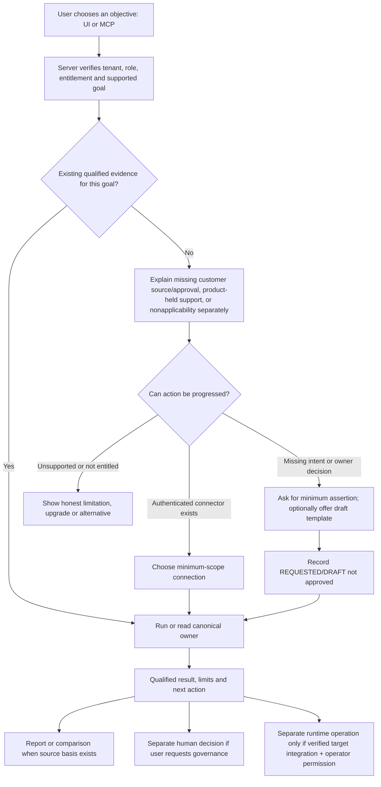

# HAIEC Pre-Devin Execution Gate and Operational Layer Alignment
**Reviewed:** 2026-10-16
**Latest inspected HAIEC Main:** `75ffb329cb75b35280456884299bfd16a9e7a0e8` (Sprint 24 scenario playback merge).
**Pending safety PR:** [#2220](https://github.com/subodhkc/haiec-website/pull/2220), head `32e54c58d9622fb26c5b035fcf471b1886109964`, originally based on `b2c1489773bd95b9e361714fbf7c808bbc866ffb`.
**Purpose:** Single decision boundary *before* Devin begins broad UX, orchestration, enterprise integration or new capability work. Documents do not assert deployed customer integration.

## Decision
**YES — operational architecture remains aligned.** Keep three explanatory product pillars **Understand / Assure / Govern & Operate**, six independently selectable jobs **Discover / Evaluate / Authorize / Monitor / Protect / Verify**, one shared deterministic evidence foundation, and conditional per-job workflow prerequisites. No forced global onboarding pipeline and no fourth mandatory final "proof" stage.

**A material release-priority change, not an architecture change:** source inspection found a missing explicit organization binding in the Kill Switch trigger route, historical browser-persistent privileged API key and legacy simulated scanner controls. These are priority safety gates before selling an enterprise runtime control demonstration. PR #2220 stages the fixes; they are neither merged nor build/runtime verified.

## Layer mapping — product words ≠ internal required execution stages
| Layer / system | Canonical owner and boundary | Customer entry | Can work independently? | Do not infer |
|---|---|---|---|---|
| Organization/identity/entitlement | server session/API key + org scope, role/plan, AI System binding | Any eligible goal | Cross-cutting required **for protected operations**, not a feature to complete | Login ≠ IAM complete / role ≠ effect permission |
| Asset discovery & topology | AI Inventory, bound sources/assets, system Action Map | Discover, Understand | Yes | Discovered ≠ verified, registered ≠ connected |
| Source ingestion & qualification | EvidenceEnvelope, source/binder, schema/lineage, producer readiness | Any evidence-based goal | Reusable shared foundation | Received ≠ qualified, no observed signal ≠ no activity |
| Requested + approved boundaries | Requested capability declaration, approved Operating Envelope | Authority review, DAI, governance | Optional for code-only discovery; essential when claiming authorization | User manifest/DRAFT ≠ approved delegation |
| Granted + code-capable + observed planes | Bounded IAM/provider, Joern/source, runtime evidence | Selected assurance questions | Each plane independently present/absent | Five planes are orthogonal evidence dimensions, **not five setup stages** |
| Audit Orchestrator | `lib/audit-orchestrator/orchestrator.ts`, contract adapters, registry, selectedEngines normalizer, event log | Selected run/evaluation | Internally sequential/fail-fast *within selected run*, not every product workflow | Run complete ≠ all planes proven; inactive engine ≠ negative result |
| Deterministic U5 / DAI / controls | Evidence set and profile resolver, DAI/effect comparisons, executable controls | Evaluate | Available as supported evidence-goal selection; needs relevant inputs | CATALOGED != EXECUTABLE != EVALUATED; REVIEW != ALLOW |
| Human governance | Versioned Operating Envelope; separate deployment decision + assigned human reviewer | Authorize | Independently invoked; user authority specific | Approved policy ≠ approved deployment ≠ actual target execution |
| Runtime monitoring & drift | OTLP/structured intake, source health, risk/findings, differential/alerts | Monitor | **Yes** with qualified runtime sources; no prior scan universal | UI refresh/SSE != complete collection; received trace != applied effect |
| Guardrail / Kill Switch control | Guardrail decision persistence, operator API, target-side execution guard | Protect | **Yes** when authorized and actually integrated; does not depend on U5 scan | State update != universal blocked calls; logged policy != enforced policy |
| Evidence outputs / historical change | U6, report/passport, consequence delta, Compliance Twin, report verification | Verify | Depends on exact owned evaluation/decision/snapshot as appropriate | Hash != guaranteed immutability; historical != current |
| Synthetic demo (Sprint 24) | `lib/demo/scenario-playback.ts`, imported manufacturing scenario, `components/governance/ScenarioPlayer.tsx` | Website storytelling and explicit demo mode only | **Separate fictional presentation**, not a customer evidence source | Synthetic "monitoring established"/approved ≠ actual operational receipt |

**Audit-orchestrator nuance:** its state machine coordinates **inventory, static, runtime, wizard, regulatory** selections, with version freeze and contract checks. That is a *run's internal implementation*, not a universal precondition that an organization must first run every engine before telemetry/guardrails or compliance. The canonical selected-engine normalizer rejects malformed persisted participation (do not portray disabled/invalid as a clean empty run).

## Customer journey shape (all steps conditional to selected goal)

Do not allow an LLM to compute an assurance disposition. It may help collect missing context, draft an optional `haiec.json`, `CAPABILITIES.md`, `BOUNDARY.md`, `GUARDRAILS.md` or `AGENTS.md`, prepare source navigation and show next actions. Draft content requires explicit approval before becoming policy. Do not demand these files from customers who have suitable connected IAM/policy/telemetry sources.

### Persona / organization applicability
- **Developer, solo or startup:** authorized repository or local bounded evidence → source/static finding and consequence map → optional policy review/report. No SSO, IAM or production monitor required.
- **Security / AppSec / AI operator:** system map, IAM/telemetry as available → DAI/protection gap → monitoring or selected guard operation only with target-specific proof. No formal annual compliance prerequisite.
- **Governance / compliance / auditor:** organization portfolio, framework applicability, approved authority, controls, human decision and exact evidence receipts. Code scanner optional when control does not require code.
- **Executive:** portfolio consequence, owned decisions, high-risk change, coverage and evidentiary frontier. No technical scanner configuration as entry requirement.
- **Different organizations:** independent feature entitlements, roles, system applicability, supported sources, source freshness and verified control integration. No shared truth or cross-tenant fallthrough; nonapplicable is not missing.

## What was verified versus what remains to prove
### Verified in inspected source
1. Main now has Sprint 24 synthetic governance playback with `origin: SIMULATED`, single deterministic virtual clock, and no real decision/control writes. Governance demo labels explicitly distinguish fictional records from live authenticated workflows.
2. Human deployment decision statuses include `PENDING`, `APPROVED_SCOPED`, `APPROVED_CONDITIONAL`, `REJECTED`, `REVOKED`, `SUPERSEDED`. These are not U5 dispositions or runtime authorization.
3. Approved Operating Envelopes are versioned. DRAFT cannot establish `POLICY_AUTHORIZED`. Unknown required policy parameter remains REVIEW.
4. Monitoring read model projects tenant-bound observations and explicitly does not establish comprehensive runtime capture or assurance by itself.
5. Evidence-driven Guided Assurance derives typed gap resolution owners, including `USER_INPUT_REQUIRED`, `USER_APPROVAL_REQUIRED`, `HAIEC_UI_ACTION_REQUIRED`, `EXTERNAL_SYSTEM_REQUIRED`, `NOT_CURRENTLY_RESOLVABLE`; reuse this instead of another "missing manifest" wizard.
6. MCP guide already maps 13 granular user goal families to registered scoped tools. Six product families are navigation groupings, **not exactly six MCP tools**.
7. The Audit Orchestrator is sequential **inside a selected run**, not mandatory for independent monitoring or operational stop/recovery.
8. Main advanced by three new commits after PR #2220 branch originated; the new files are Sprint 24 governance and website playback, not these P0 fixes.

### Not established
- PR #2220 Vitest/TypeScript execution (previous GitHub checks were skipped), successful Vercel preview, Main merge and production deploy.
- One customer's real API/tool execution hook and an independently proven applied enforcement receipt.
- Exhaustive every-route/producer implementation parity or full customer entitlements across plan/organization types.
- The absence of all unmediated runtime action paths.
- Same effect story across synthetic demonstration and production; they are deliberately separate evidence origins.

## Immediate pre-Devin decisions — no new implementation
1. **Freeze the contract:** three pillars, six optional jobs, five independent evidence planes, separate human decision and runtime enforcement, source-bound reporting. Mark architecture **BASELINE**, not implementation finished.
2. **Set one active code work item:** PR #2220 validation. Run focused tests, limited compile/build checks, cross-tenant negative case and proper tenant operational smoke. Review changes against new Main and refresh branch if needed. Do not merge merely because GitHub displays mergeable.
3. **Confirm mandatory risk boundaries:** no fabricated provider controls; no cross-organization trigger; no privileged long-term browser key; no universal kill speed/automatic monitoring claims; no synthetic demo truth promotion. Decide whether to implement server-side/session auth now or keep explicitly in next security release gate.
4. **Choose only one next flagship:** one **governed consequential action** in a safe AWS AgentCore Gateway test target, with requested/approved/capable/observed facts, decision, gateway policy mode, denial receipt and limitations. Do not demand all planes and controls be present to start static assurance elsewhere.
5. **Audit sample journeys, not entire estate:** developer source scan, governance human approval, monitoring-only source, operator kill/recover (where integrated), auditor control/reports, executive portfolio. Capture expected permission, evidence state, next action and refusal/no-evidence outcomes.
6. **Define exit criteria:** PR tests/quality gates, merged Main head, verified Vercel deploy, updated planning source links, demo provenance boundaries and no duplicate router/engine. Only then start broader UX convergence.

## Devin bounded execution packet — first handoff

### Task A, mandatory / first
On the latest Main, reconcile and close PR #2220 safely. No test explosion. Run `npx vitest run tests/unit/legacy-simulated-provider-quarantine.test.ts tests/security/kill-switch-trigger-tenant-boundary.test.ts`, targeted typecheck/build smoke, test correct-org vs foreign-org trigger, confirm recovery unchanged, verify the displayed control scope and browser key handling. Keep guardrail/control states independent. Review and merge after gates pass; Main triggers Vercel production, verify deployment. Do not modify or reconnect Vercel Git identity.

### Task B, only after A
Complete source/permission evidence census for the 16 priority workflows in `UI-MCP-API-WORKFLOW-AVAILABILITY-RECONCILIATION.csv`, then expand the 87 curated entries and 20 candidate modules with source-anchored release state. Reuse `lib/mcp/capability-guide.ts`, `lib/mcp/guided-assurance.ts`, `lib/ai-inventory/system-next-action.ts`, `lib/ai-inventory/evaluation-source-preflight.ts`, existing product-surface, entitlement and producer registries. No parallel orchestration, evidence store, decision engine or capability truth database.

### Task C, design only until specific signed-off customer pilot
Surface scoped `READY / SOURCE_NEEDED / HUMAN_APPROVAL_NEEDED / NOT_ENTITLED / NON_APPLICABLE / HELD_OR_UNSUPPORTED` in user-friendly language **as display projections** derived from canonical data. Avoid creating new persisted verdict enums. Provide role-/plan-aware UI and equivalent MCP guidance where authorized. Human approvals and emergency operational mutations may remain UI/API-only pending appropriate safety.

### Task D, after selected pilot authorized
Implement narrowly scoped read-only AWS AgentCore policy-mode and action evidence binding, then prove one permitted action, one denied action and one unknown. Do not build another policy engine or assume LOG_ONLY enforces.

**Stop conditions:** Unexpected changes to Main, missing CI permissions, missing correct-org smoke environment, Vercel preview blocked, unknown secrets or ambiguous target authority → document blocker, preserve branch, do not falsely report a release. No mass route renames or scanner replacement.

## Required handoff files (already in common-repo-drive)
- `PRODUCT-TRUTH-WORKFLOW-REACHABILITY-AND-P0-CORRECTIONS-2026-10-16.md`
- `PRODUCT-TRUTH-RELEASE-GATE-STATUS.json`
- `UI-MCP-API-WORKFLOW-AVAILABILITY-RECONCILIATION.csv`
- `PRODUCT-UX-OPERATIONAL-REVIEW-AND-DECISION-2026-10-16.md`
- `OWN-REUSE-INTEGRATE-DEFER-ENTERPRISE-STRATEGY-2026-10-16.md`
- `HAIEC-PRODUCT-CAPABILITY-WORKFLOW-MATRIX.md`
- `DEVIN-HANDOFF.md`

This document is a current alignment/acceptance decision, not a verified deployment or a replacement for the canonical capability matrix.
